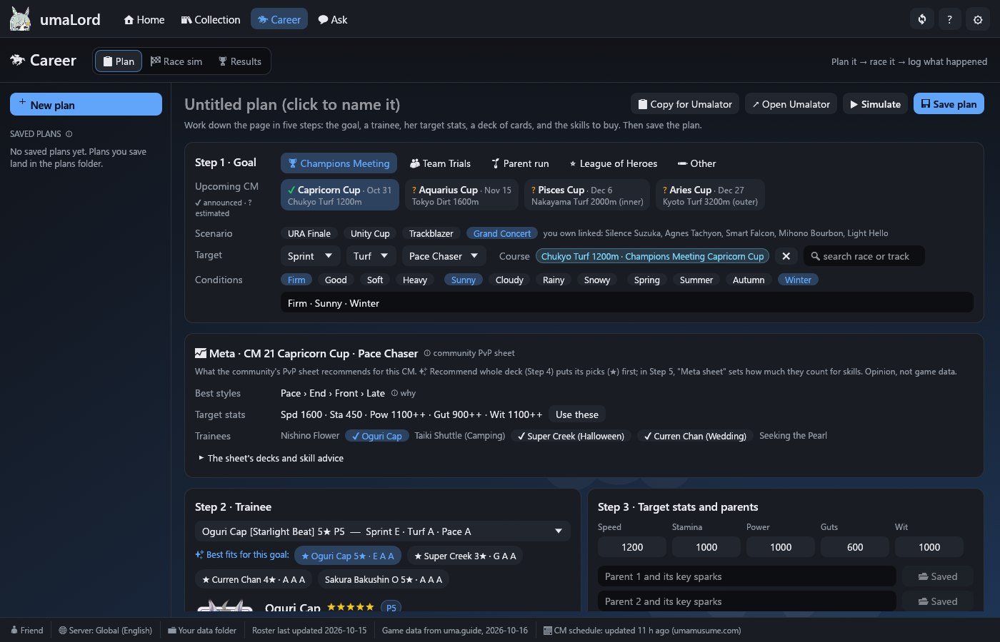
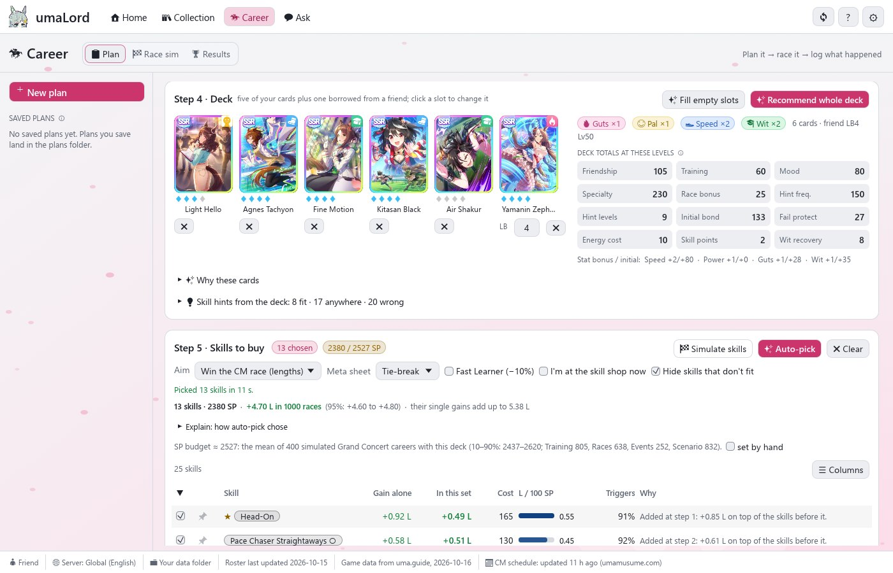
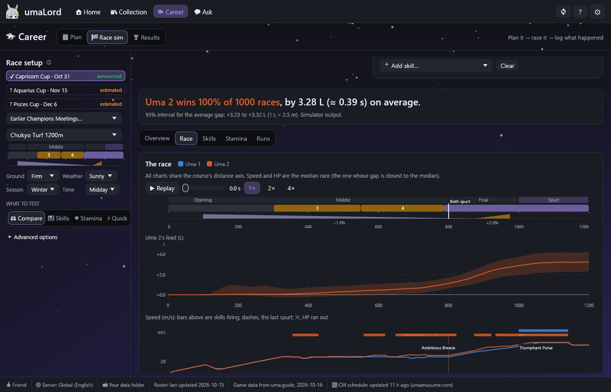
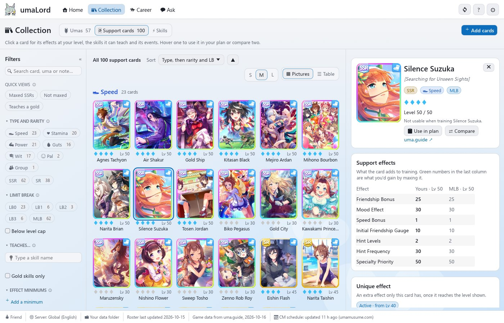
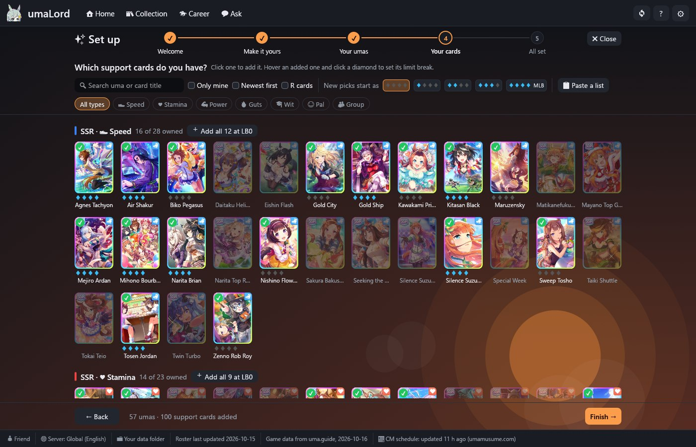
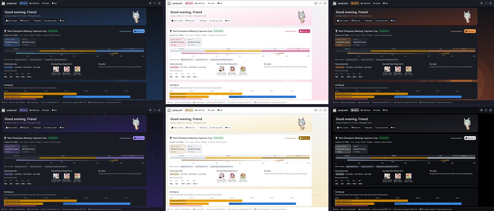

<p align="center">
  
</p>

<h1 align="center">umaLord</h1>

<p align="center">
  A desktop companion for your <b>Uma Musume: Pretty Derby</b> (Global) account:<br>
  your collection, career plans built on the community meta, and a race simulator. Everything runs offline.
</p>

<p align="center">
  <a href="https://github.com/brickc4/umaLord/releases/latest"></a>
  <a href="https://github.com/brickc4/umaLord/actions/workflows/ci.yml"></a>
  
  
  <a href="LICENSE"></a>
</p>



## What it does

| | |
|---|---|
| 🏠 **Home** | The next Champions Meeting at a glance: announced or estimated, its course drawn, what the community meta sheet recommends, your best umas for it and your plan. Below: what's coming up in the game's news, and your stable in charts. |
| 📋 **Plan a career** | Pick the next Champions Meeting and a trainee. Trainee suggestions and the deck fill start from the community PvP meta sheet's picks for that CM and running style (marked ★); simulated careers rank the rest. ✨ Auto-pick races the skills on offer and keeps the set that gains the most together, within the skill points your simulated careers end with. |
| 🏁 **Race sim** | A Rust port of Moomoolator's race engine, checked against umalator.app. Race two builds 1,000 times and see where the lengths are won, speed and HP over the race, and what each skill is worth; check stamina. No browser needed. |
| 📚 **Collection** | Your umas and support cards, with effects at your limit break and level, the skills they teach, and their events. Every skill in the game, with the ones that can trigger on a course and the community tier list. |
| ✨ **Set up in minutes** | Click the umas and cards you own, or load a profile file someone saved for you. ⚙ Settings → Save my data puts your whole account in one file. |
| 💬 **Ask** | Questions about your roster in plain English, answered by a free OpenCode model or your own Claude API key. It can also build a plan, pick the deck and skills, and race it in the simulator for you, asking before it saves anything. |
| 🎨 **Themes** | Seiun Sky, Sakura, Sunset, Starry night, Track day and the high-contrast Ink, in dark or light, or following Windows. |

<table>
  <tr>
    <td></td>
    <td></td>
  </tr>
  <tr>
    <td align="center">The deck and skills to buy</td>
    <td align="center">Race sim: two builds, 1,000 races</td>
  </tr>
  <tr>
    <td></td>
    <td></td>
  </tr>
  <tr>
    <td align="center">Collection, with effects at your level</td>
    <td align="center">Setup: click what you own</td>
  </tr>
</table>

## Get it

1. Download the zip from **[Releases](https://github.com/brickc4/umaLord/releases/latest)** and unzip the whole folder anywhere.
2. Run `umalord.exe`. It isn't signed, so Windows may say *"Windows protected your PC"*: click **More info**, then **Run anyway**.
3. Setup opens on the first run. Load a `.umalord.json` profile (drag it onto the window), or click the umas and cards you own.

Needs Windows 10 or 11, 64-bit. Your data stays on your computer, in the `account` folder next to the app.

Every release is built and tested by [GitHub Actions](https://github.com/brickc4/umaLord/actions) from the tagged source. What changed is in the [changelog](CHANGELOG.md).

## Themes



## How the picks work

- **Meta first for cards.** For a plan aimed at a Champions Meeting, each card gets a rating (★ to ★★★) from how many of the community sheet's decks for that CM and running style include it: Whale, Standard and Beginner decks, and honorable mentions. A copy at a low limit break counts for less.
- **Races for skills.** Auto-pick races each skill on offer in the simulator, then builds the set step by step, adding whichever skill gains the most on top of those already chosen per skill point, and checks the final set in 1,000 races. The sheet's skill advice breaks ties by default; in Step 5 you can make it count more, or not at all.
- **Simulation for the rest.** Among cards with the same rating, and for anything the sheet doesn't cover, each card is scored by what it adds to simulated careers in the CM's scenario (stats toward your targets, skill points, scenario links), plus the lengths its skills gain on the course in the race simulator.
- These are suggestions, not a solved optimum. The career model's assumptions are listed, each marked sourced or assumed, in [`knowledge/scenarios.json`](knowledge/scenarios.json).

## Build from source

Needs [Rust](https://rustup.rs) with the `stable-x86_64-pc-windows-gnu` toolchain and its `llvm-tools` component.

```powershell
cd app
powershell -ExecutionPolicy Bypass -File setup-toolchain.ps1
cargo build --release
```

The exe is `app/target/release/umalord.exe`. `cargo test --release` runs the tests, including a check of the race engine against umalator.app.

Game data lives in `knowledge/data/`. To refresh it from uma.guide, umalator.app and the meta sheet (needs Python 3):

```powershell
python -I -X utf8 tools/update_knowledge.py
```

Add `--only meta` to refresh just the meta sheet. `tools/package.ps1 -Build` makes the release zip locally; it never includes your account.

**Releasing:** add the version's section to [CHANGELOG.md](CHANGELOG.md), bump `version` in `app/Cargo.toml`, then push a tag:

```powershell
git tag v0.1.2
git push origin v0.1.2
```

The [Release workflow](.github/workflows/release.yml) builds, tests and packages it, and publishes the release with that changelog section as its notes.

## Bugs and ideas

[Open an issue](https://github.com/brickc4/umaLord/issues/new/choose). There's a short form for bug reports and one for ideas. Issues are public, so don't attach your profile file unless you're happy to share it.

## Use it with Claude Code

Open the folder in Claude Code. [`CLAUDE.md`](CLAUDE.md) tells Claude how to keep your roster up to date from screenshots, simulate saved plans, log real results, and keep evidence-backed opinions in `insights.md`.

### umaLord's tools in Claude Code or Claude Desktop (MCP)

`umalord.exe --mcp <folder>` serves the same tools the Ask tab uses (your roster, the game data, the meta sheet, the CM schedule, the planner and the race simulator) as an MCP server over stdio. Point it at your umaLord folder.

Claude Code:

```
claude mcp add umalord -- C:\path\to\umaLord\umalord.exe --mcp C:\path\to\umaLord
```

Claude Desktop, in `claude_desktop_config.json`:

```json
{
  "mcpServers": {
    "umalord": { "command": "C:\\path\\to\\umaLord\\umalord.exe", "args": ["--mcp", "C:\\path\\to\\umaLord"] }
  }
}
```

Without the app's window, the tools that write files (`save_plan`, `log_result`, `update_owned`) run when called, so leave your client's per-tool approval on. Plans it saves appear in the app's Planner under Saved plans.

## Credits

- **Game data:** [uma.guide](https://uma.guide): umas, cards, skills, races and events.
- **Race simulator:** a port of [Moomoolator](https://umalator.app) ([TheCing/uma-tools](https://github.com/TheCing/uma-tools)), which builds on alpha123's Umalator and kachi-dev's VFalator.
- **Meta picks:** the community "PvP Deck & Uma Recommendation" sheet by Lightning, Daptrius and Henry.
- **Chibi art:** [GameTora](https://gametora.com).

Uma Musume: Pretty Derby is © Cygames, Inc. umaLord is an unofficial fan project, not affiliated with or endorsed by Cygames.

## License

[GPL-3.0-or-later](LICENSE): the race simulator ports Moomoolator, which is GPL-3.0-or-later.
