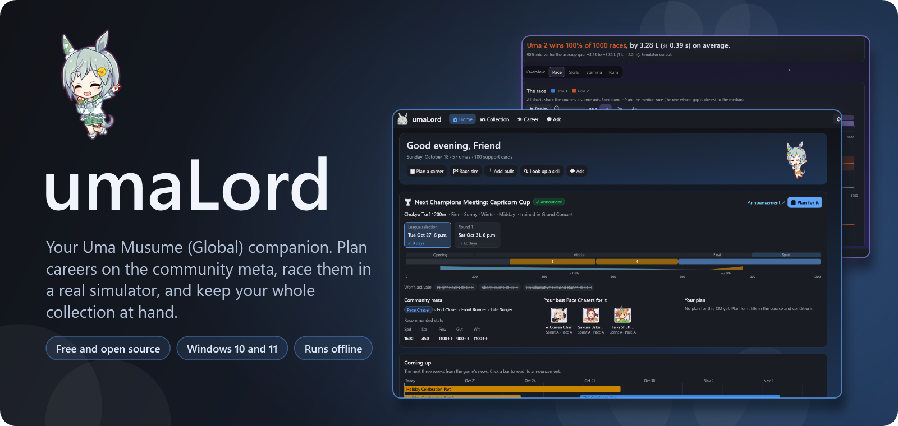
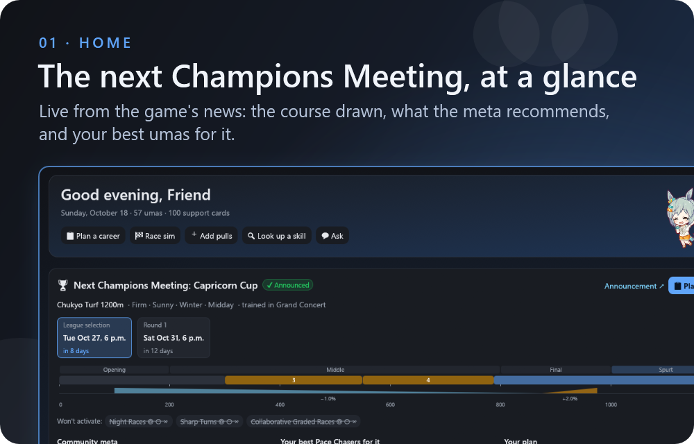
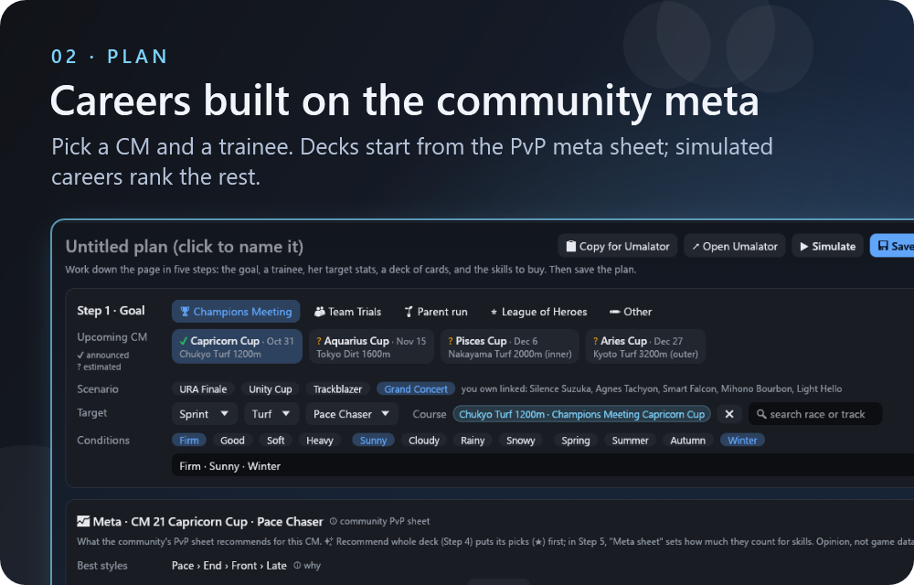
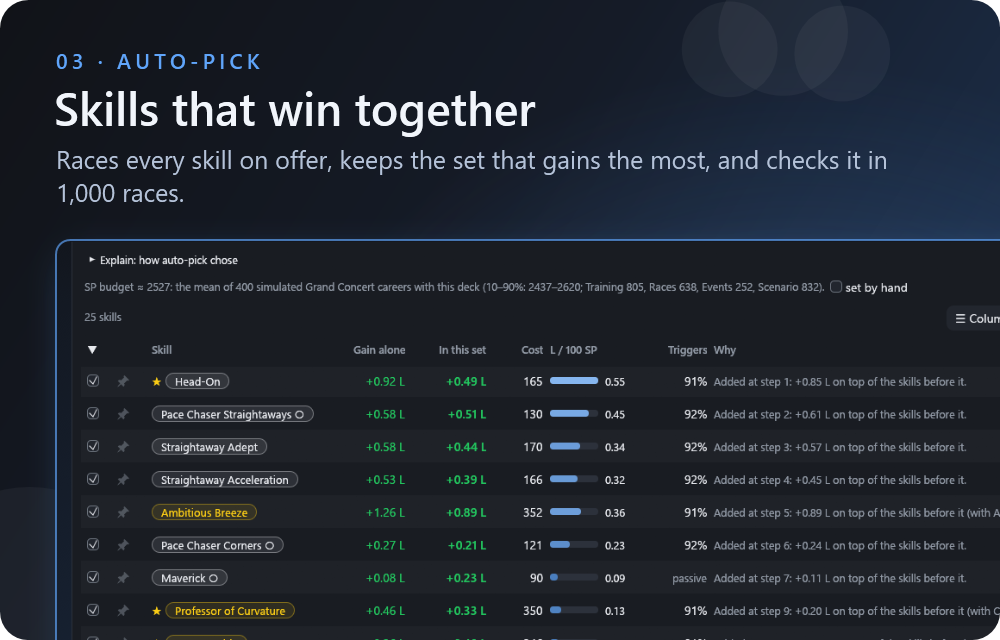
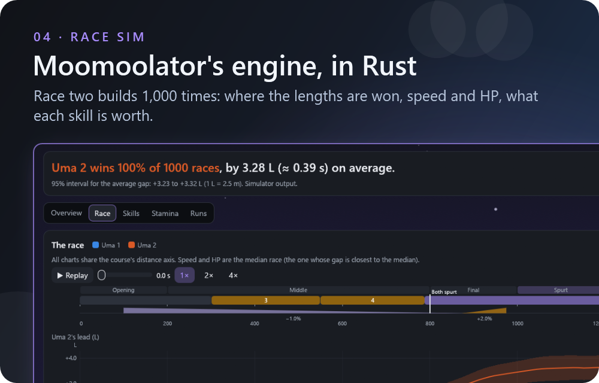
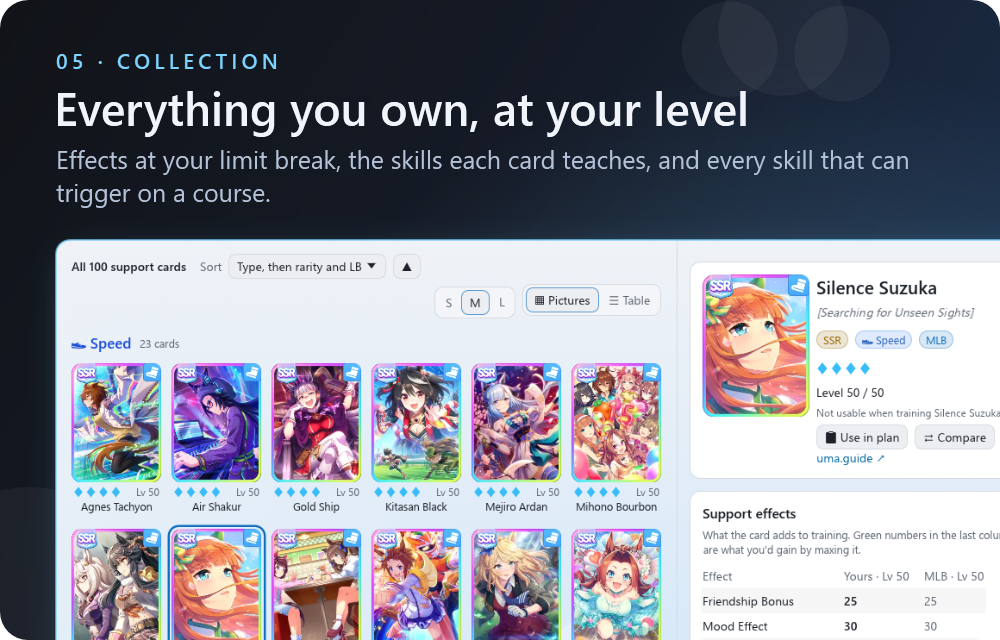
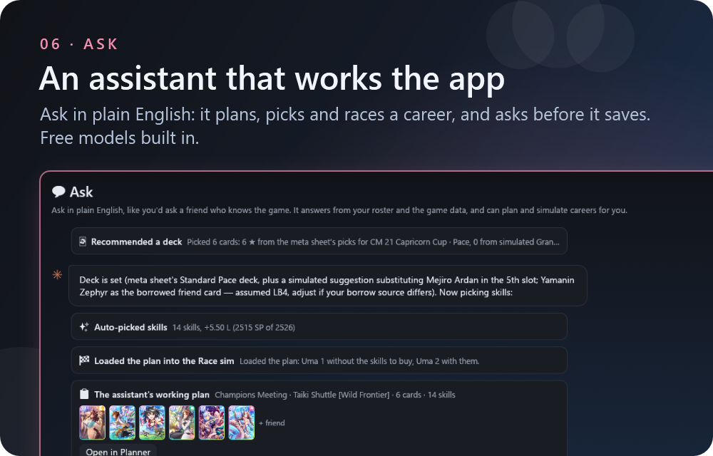
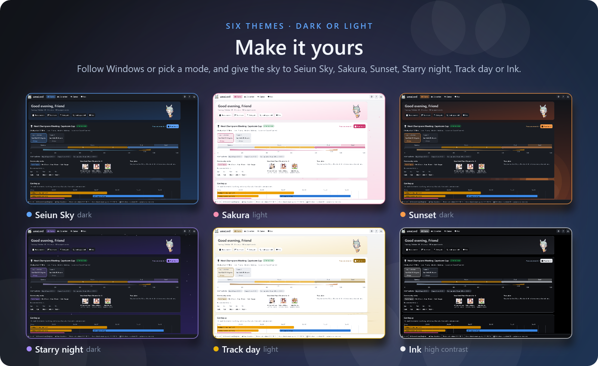
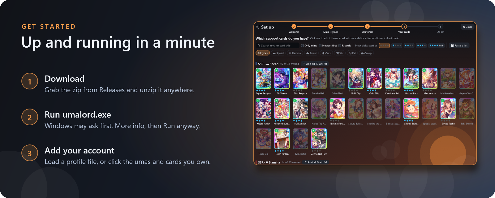

<p align="center">
  
</p>

<p align="center">
  <a href="https://github.com/Nyakij/UmaYu/releases/latest"></a>
  <a href="https://github.com/Nyakij/UmaYu/actions/workflows/ci.yml"></a>
  
  <a href="LICENSE"></a>
</p>

<h3 align="center">Plan it. Race it. Log what happened.</h3>

<p align="center">
  A desktop companion for your <b>Uma Musume: Pretty Derby</b> account on the Global server. It knows your umas and cards at their real limit breaks, reads the community meta for every Champions Meeting, and races your builds in a port of Moomoolator's engine before you spend a single career on them.
</p>

<br>

<table>
  <tr>
    <td width="50%"></td>
    <td width="50%"></td>
  </tr>
  <tr>
    <td width="50%"></td>
    <td width="50%"></td>
  </tr>
  <tr>
    <td width="50%"></td>
    <td width="50%"></td>
  </tr>
</table>

<details>
<summary><b>…and everything else it does</b></summary>

<br>

- 📅 **Live Champions Meeting schedule** from the game's official news and Umalator's presets: announced or estimated, countdowns in your time zone, and the skills each CM turns off (auto-pick never buys those).
- 🛒 **Skill shop mode**: at the end of a real career, enter your final stats and SP and tick what's on offer; auto-pick works on exactly that.
- 🎯 **Three aims for skills**: win the CM race in lengths, Team Trials (gains weighted by how often they trigger), or rating points for a parent's spark stars.
- ⚠️ **Aptitude warnings**: a grade below B for the goal shows what it costs her, from the simulator's own coefficients.
- 📈 **Race sim charts**: the gap of every race, where along the course the lengths are won, speed and HP of the typical race with a replay, a timeline of every skill, what each skill is worth and where the next training points matter.
- 🃏 **Compare two cards** side by side at your levels, filter cards by a skill they teach or an effect's minimum, and see the community tier list on every skill.
- 🧩 **Setup in minutes**: click what you own on art grids, paste a list, or load a profile file. ⚙ Settings → Profile → Save my data puts your whole account in one file.
- 🎵 **Game Audio & Music tab (optional)**: connect to your local game installation (Global or JP) in Settings → Game audio to browse game sounds, listen to Jukebox songs (Short & Game-size with automatic fallback), and stage multi-track Live concerts with synced karaoke lyrics, custom character lineups, and 16-bit WAV export to `exports/audio/`. Runs 100% locally and offline.
- ⌨️ **Keyboard shortcuts**: Ctrl+1–5 for tabs (Ctrl+5 for Music when enabled), Ctrl+, for Settings, Ctrl+F to search, Ctrl+S to save the plan, F5 to reload, ? for help.
- 🤖 **MCP server**: the assistant's tools work in Claude Code and Claude Desktop too ([below](#-use-it-with-claude-code)).

</details>

<br>

<p align="center">
  
</p>

<p align="center">
  <a href="https://github.com/Nyakij/UmaYu/releases/latest"></a>
</p>

<p align="center">
  <a href="https://github.com/Nyakij/UmaYu/releases/latest"><b>⬇️ Download the latest release</b></a>
  &nbsp;·&nbsp;
  <a href="CHANGELOG.md">What's new</a>
  &nbsp;·&nbsp;
  <a href="https://github.com/Nyakij/UmaYu/issues/new/choose">Report a bug or suggest an idea</a>
</p>

<p align="center"><sub>Windows 10 or 11, 64-bit. Your data stays on your computer, in the <code>account</code> folder next to the app.<br>Every release is built and tested by <a href="https://github.com/Nyakij/UmaYu/actions">GitHub Actions</a> from the tagged source.</sub></p>

## 🧠 How the picks work

Every pick is labelled for what it is: game data, simulator output, community meta, or opinion.

- **Meta first for cards.** For a plan aimed at a Champions Meeting, each card gets a rating (★ to ★★★) from how many of the community sheet's decks for that CM and running style include it: Whale, Standard and Beginner decks, and honorable mentions. A copy at a low limit break counts for less.
- **Races for skills.** Auto-pick races each skill on offer in the simulator, then builds the set step by step, adding whichever skill gains the most on top of those already chosen per skill point, and checks the final set in 1,000 races. The sheet's skill advice breaks ties by default; in Step 5 you can make it count more, or not at all.
- **Simulation for the rest.** Among cards with the same rating, and for anything the sheet doesn't cover, each card is scored by what it adds to simulated careers in the CM's scenario (stats toward your targets, skill points, scenario links), plus the lengths its skills gain on the course in the race simulator.
- **Suggestions, not a solved optimum.** The career model's assumptions are listed, each marked sourced or assumed, in [`knowledge/scenarios.json`](knowledge/scenarios.json). The race engine is checked against umalator.app on every test run.

## 🤖 Use it with Claude Code

Open the folder in Claude Code. [`CLAUDE.md`](CLAUDE.md) tells Claude how to keep your roster up to date from screenshots, simulate saved plans, log real results, and keep evidence-backed opinions in `insights.md`.

`umayu.exe --mcp <folder>` serves the same tools the Ask tab uses (your roster, the game data, the meta sheet, the CM schedule, the planner and the race simulator) as an MCP server over stdio. Point it at your UmaYu folder.

**Claude Code:**

```
claude mcp add umalord -- C:\path\to\UmaYu\umayu.exe --mcp C:\path\to\UmaYu
```

**Claude Desktop**, in `claude_desktop_config.json`:

```json
{
  "mcpServers": {
    "umalord": { "command": "C:\\path\\to\\UmaYu\\umayu.exe", "args": ["--mcp", "C:\\path\\to\\UmaYu"] }
  }
}
```

Without the app's window, the tools that write files (`save_plan`, `log_result`, `update_owned`) run when called, so leave your client's per-tool approval on. Plans it saves appear in the app's Planner under Saved plans.

## 🎵 Game Audio Plug-in

UmaYu includes an optional, privacy-respecting audio player and multi-track live stage mixer that reads assets directly from your local game installation (Global, Steam JP, or DMM JP).

- **How to enable & Navigation:**
  - Open **⚙ Settings** (top right or `Ctrl+,`) → **Game audio**, tick **Enable game audio plug-in**, and click **Auto-detect** (or select your game's `Persistent` folder manually).
  - The plug-in is disabled by default, keeping UmaYu completely lightweight and clean for users who do not have the game installed.
  - Once enabled, a **🎵 Music** tab appears in the top navigation bar (accessible anytime via **Ctrl+5**).
- **100% Local & Offline Privacy Guarantee:** All asset reading, decryption (CRIWARE ACB/AWB/HCA), UnityFS score decompression, and audio playback happen entirely offline on your computer. No game files, audio streams, or user data are ever uploaded or transmitted anywhere.
- **Three Dedicated Sub-Tabs:**
  - **📁 Files (Asset Explorer):** Browse raw game sound archives categorized into 6 sections: *BGM*, *Cutin*, *Jingle*, *Live*, *System*, and *Voice*. Features instant background search indexing, cue inspection, duration and format metadata, individual cue previewing, and batch archive extraction.
  - **📻 Jukebox Player:** Browse the game's full jukebox catalog with dual **Short** preview and full **Game-size** playback, featuring smart fallback if a version is not yet downloaded on disk. Includes real-time search, category/version filters, and one-click playback.
  - **🎤 Live Stage Player:** Interactive multi-channel live music mixer supporting backing tracks (`oke`), audience cheering SFX, UnityFS score parsing (`lz4_flex`), synchronized scrolling karaoke lyrics, and customizable character vocal assignments with independent volume, solo, and singing mode controls (Auto, Force Main, Force Extra, Force Merge, Mute).
- **Persistent Bottom Mini-Player:**
  - A persistent control bar sits at the bottom of the Music tab across all sub-tabs.
  - Provides quick play/pause, stop, seamless loop toggle, high-precision seek bar with current and total time display, master volume slider, and one-click WAV export without interrupting browsing.
- **💾 Audio Export (`exports/audio/`):**
  - Export single wave cues, complete ACB/AWB archives, jukebox tracks, and full multi-channel live mixes directly to standard 16-bit PCM RIFF WAV format.
  - All exported files are saved to the `exports/audio/` folder located directly next to the app executable.

## 🛠️ Build from source

<details>
<summary>Toolchain, tests, game data and releases</summary>

<br>

Needs [Rust](https://rustup.rs) with the `stable-x86_64-pc-windows-gnu` toolchain and its `llvm-tools` component.

```powershell
cd app
powershell -ExecutionPolicy Bypass -File setup-toolchain.ps1
cargo build --release
```

The exe is `app/target/release/umayu.exe`. `cargo test --release` runs the tests, including a check of the race engine against umalator.app.

Game data lives in `knowledge/data/`. To refresh it from uma.guide, umalator.app, the meta sheet and the skill tier list (needs Python 3):

```powershell
python -I -X utf8 tools/update_knowledge.py
```

Add `--only meta` to refresh just the meta sheet. `tools/package.ps1 -Build` makes the release zip locally; it never includes your account. `tools/readme_art.ps1` redraws the art on this page from fresh screenshots.

**Releasing:** add the version's section to [CHANGELOG.md](CHANGELOG.md), bump `version` in `app/Cargo.toml`, then push a tag:

```powershell
git tag v0.2.1
git push origin v0.2.1
```

The [Release workflow](.github/workflows/release.yml) builds, tests and packages it, and publishes the release with that changelog section as its notes.

</details>

## 🐛 Bugs and ideas

[Open an issue](https://github.com/Nyakij/UmaYu/issues/new/choose). There's a short form for bug reports and one for ideas. Issues are public, so don't attach your profile file unless you're happy to share it.

## 💙 Credits

- **Game data:** [uma.guide](https://uma.guide): umas, cards, skills, races and events.
- **Race simulator:** a port of [Moomoolator](https://umalator.app) ([TheCing/uma-tools](https://github.com/TheCing/uma-tools)), which builds on alpha123's Umalator and kachi-dev's VFalator.
- **Audio & asset decoding:** [cridecoder](https://crates.io/crates/cridecoder) (CRIWARE ACB/AWB/HCA decoding), [cpal](https://crates.io/crates/cpal) (low-latency WASAPI output), [rusqlite](https://crates.io/crates/rusqlite) (SQLite manifest reading), and [lz4_flex](https://crates.io/crates/lz4_flex) (pure Rust UnityFS LZ4 block decompression).
- **Meta picks:** the community "PvP Deck & Uma Recommendation" sheet by Lightning, Daptrius and Henry.
- **Skill tiers:** the community "Uma Musume Skills Spreadsheet" tier list by Dylan, formatted by sayaduck.
- **Guides:** GameTora, uma.guide and other community guides, each cited in [`knowledge/mechanics.md`](knowledge/mechanics.md).
- **Chibi art:** [GameTora](https://gametora.com).

**License:** [GPL-3.0-or-later](LICENSE), because the race simulator ports Moomoolator, which is GPL-3.0-or-later.

<p align="center">
  
</p>

<p align="center"><sub>Uma Musume: Pretty Derby is © Cygames, Inc. UmaYu is an unofficial fan project, not affiliated with or endorsed by Cygames.</sub></p>
